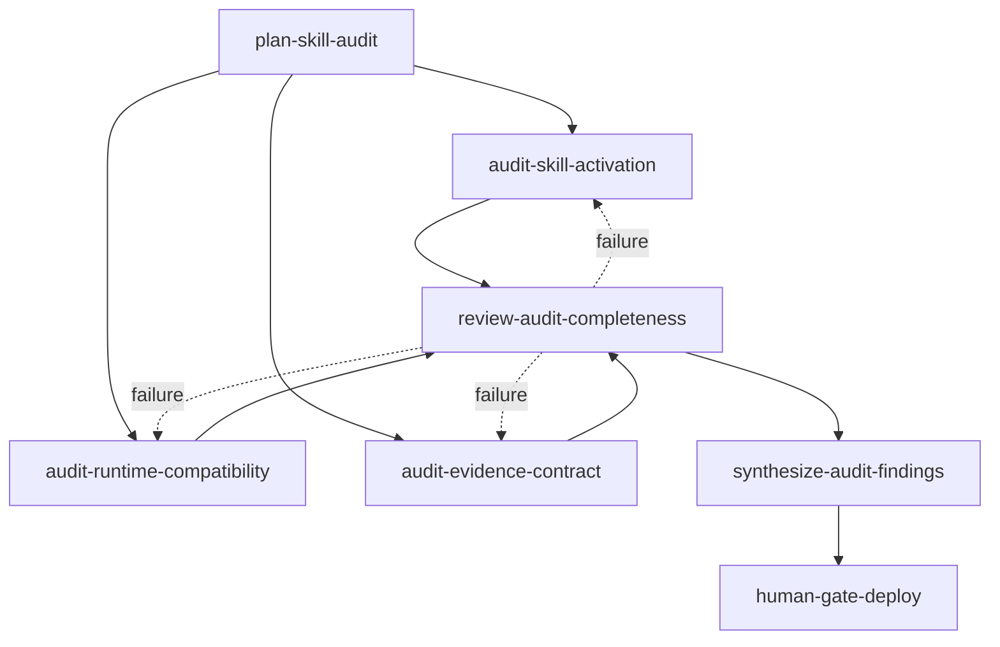

# Example: Skill-Library Consistency Audit

This graph applies graph engineering to the repository's real skill-library maintenance workflow. It audits three independent dimensions in parallel, reviews completeness separately, and pauses before deployment.

The machine-readable definition is `../tests/skill-library-audit.json`.

## Diagram



## Why this shape

- **Parallel audit dimensions:** activation metadata, runtime compatibility, and evidence contracts can be investigated independently from the shared audit scope.
- **Explicit contracts:** each worker declares preconditions, postconditions, and a structured failure output; `inputs` and `outputs` are the edge-level data contract.
- **Independent review:** one completeness reviewer asks one question and cannot silently replace the specialized audit work.
- **Failure routing:** failed completeness checks route back to bounded workers instead of disappearing inside a synthesis prompt.
- **Human gate:** deployment approval is the only irreversible action in this graph and is explicitly gated.
- **Runtime truth:** `runtime_refs` are checked only when the validator receives `--runtime-root`; no network discovery or unavailable integration is implied.

## Validation

```bash
python3 ../scripts/validate_graph.py \
  --runtime-root "$PWD/../.." \
  ../tests/skill-library-audit.json
```

The graph is design-time and validation-only. Use the runtime map in `../references/graph-to-runtime.md` to choose an available execution surface; do not treat this fixture as an execution engine.
